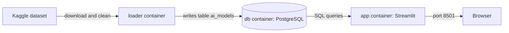

# AI model prices and abilities, 2023 to 2026

How have the prices and abilities of AI models changed? We answer it with weekly snapshots of 4,297 model listings from 43 developers (167,787 rows, September 2023 to September 2026), loaded into PostgreSQL and shown in a Streamlit dashboard.

## Team
| Name | GitHub username |
| --- | --- |
| Anna Granzotto | annagranzotto |
| Camilla De Marco | camillademarco |
| Irene Rossi | irirossi-cell |
| Luigi Campece | luigicmp |
| Sabrina Mammino | sabrinamammino |
| Sandra Carine Keza Teta | KezaTeta |
## How to run

You need Docker Desktop and Git. No Kaggle account is needed.

1. Install Docker Desktop and start it.
2. Clone the repository and open the folder:
   ```
   git clone https://github.com/sabrinamammino/Computing-Infrastracture.git
   cd Computing-Infrastracture
   ```
3. Copy the settings template to your private settings file.
   Windows PowerShell: `copy .env.example .env`. Mac or Linux: `cp .env.example .env`.
4. Start everything:
   ```
   docker compose up --build
   ```
   The first build downloads the libraries and the data and can take several minutes.
5. Open http://localhost:8501

To stop: press `Ctrl + C`, then run `docker compose down`.
If the page shows an error, look at the loader: `docker compose logs loader`.
## Data

- **Source:** [AI Models and API Pricing 2026: Price History](https://www.kaggle.com/datasets/abirambharathisa/ai-models-and-api-pricing-2026-price-history) on Kaggle, version 2.
- **Licence:** the Kaggle page does not state a licence. The price data comes from the LiteLLM project (Berri AI), which is under the MIT License (full text in `LICENSE_LiteLLM_source_data.txt`, downloaded with the data). 
- **Downloaded:** 5 November 2026
- **Size:** two CSV files, about 18 MB in total (1 MB of models, 17.5 MB of weekly price history).
- **How we get it:** the loader downloads it by itself when it starts, with no login. It checks a SHA-256 fingerprint of each file, so everybody works on exactly the same version. The data files are not stored in the repository.
## Architecture



- **db:** PostgreSQL 16. We chose SQL because every row has the same columns (price, model, provider, week), and the questions are counts, medians and comparisons that SQL does well.
- **loader:** a Python container. It downloads the two raw files, cleans and merges them (`loader/project_infrastructures.py`), then writes the table `ai_models` into the database (`loader/load_data.py`). Then it stops.
- **app:** the dashboard (`app/dashboard.py`). It starts after the loader has finished and runs five SQL queries (also in `sql/queries.sql`) to draw the charts and tables.
## Measurements

Laptop: Apple M4, 16 GB RAM, macOS 26.6.2. Each number is the average of 3 runs.

### A. Load into the database at 25%, 50% and 100% of the data

| Data | Rows | Load time (s) | Peak memory, loader (MiB) | Database size |
|---|---|---|---|---|
| 25% | 41,696 | 2.0 | 244.4 | 16 MB |
| 50% | 83,628 | 3.7 | 297.9 | 24 MB |
| 100% | 167,787 | 7.1 | 356.7 | 41 MB |

Memory is the highest value seen by `docker stats` (about one reading per second), so it is approximate. Reading the CSV always takes 0.2 s because the loader reads the whole file before taking the sample. Almost all the load time is the database write, and it grows about linearly with the number of rows: doubling the data takes about 1.8 to 1.9 times as long. The database (41 MB) is about twice the size of the original files (18 MB) because it also stores column types and row overhead.

### B. Full run and memory

Full run from an empty `data/` folder and an empty database to a working dashboard (`docker compose up --build -d`, which includes downloading, cleaning and loading): 67.4 s, 17.8 s and 17.8 s, average 34.3 s. Run 1 is slower because new code had just been pulled, so Docker rebuilt the images; runs 2 and 3 reused them. A first build on a new laptop takes longer.

Peak memory of the db container during the full run (highest reading of `docker stats`, average of 3 runs): 79.6 MiB (108.9, 64.6 and 65.2 MiB). Run 1 is higher because the dashboard was loading while the memory was still being recorded; the real peak is about 65 MiB. The loader peaks at about 358 MiB (359.3, 357.0 and 357.0), which matches the 357 MiB of the 100% row in table A. The whole system stays far below the memory of this laptop.

### C. Time of each dashboard query (100% data, no index)

Time from `EXPLAIN ANALYZE`, 3 runs each:

| Dashboard query | Run 1 (ms) | Run 2 (ms) | Run 3 (ms) | Average (ms) |
|---|---|---|---|---|
| 1. Median price per quarter | 62.0 | 55.8 | 54.1 | 57.3 |
| 2. Price cuts and rises | 161.1 | 164.6 | 160.7 | 162.2 |
| 3. Abilities per quarter | 23.1 | 23.6 | 16.3 | 21.0 |
| 4. Cheapest capable models | 12.0 | 11.8 | 11.9 | 11.9 |
| 5. Provider spread | 12.5 | 12.6 | 12.8 | 12.6 |

Every query answers in under 170 ms. The slowest is the price cuts and rises query (162 ms on average), because it compares every model with its own previous week over all the chat rows. The two queries that look only at the latest week (4 and 5) are the fastest.

### D. Index test (100% data)

Query 4 (the cheapest chat models that can read images and call functions, in the latest week). Time from `EXPLAIN ANALYZE`, 3 runs each. The index was created by hand with `CREATE INDEX idx_ai_models_week ON ai_models (week_start);`. It is not part of the loader, so it disappears whenever the loader rebuilds the table.

| Query 4 | Run 1 (ms) | Run 2 (ms) | Run 3 (ms) | Average (ms) |
|---|---|---|---|---|
| Without index | 12.0 | 11.8 | 11.9 | 11.9 |
| With index on `week_start` | 2.2 | 2.2 | 2.4 | 2.3 |

Yes, the index helps: the query is about 5 times faster (11.9 ms to 2.3 ms on average). Without the index, Postgres reads all 167,787 rows (`Parallel Seq Scan on ai_models`) just to find the latest week. With it, the plan uses `Index Only Scan Backward using idx_ai_models_week` to find the latest week, then a `Bitmap Index Scan` and a `Bitmap Heap Scan` that read only the rows of that week.
## Who did what

| Part | Person | What |
|---|---|---|
| I. Research question and dataset | Sabrina Mammino | Research question, the two original datasets, feature exploration, the merged final dataset, its size and structure |
| II. Reproducible data pipeline | Anna Granzotto | Automatic download from Kaggle, cleaning, notebook converted to a Python script (`loader/project_infrastructures.py`), credentials and reproducibility |
| III. Data loading and storage | Camilla De Marco | The loader (`loader/load_data.py`), Python requirements, data types, insertion into PostgreSQL, the choice of a relational database |
| IV. Computational infrastructure | Sandra Carine Keza Teta | Three-container architecture, `docker-compose.yml` and Dockerfiles, health checks and dependencies, networking, volumes, SQL queries and window functions |
| V. Application layer | Irene Rossi | The Streamlit dashboard (`app/dashboard.py`), connection to PostgreSQL, caching, charts, live demo and key findings |
| VI. Performance evaluation | Luigi Campece | Measurement method, 25%, 50% and 100% tests, time, memory and disk, the index test, fresh clone test, conclusions |