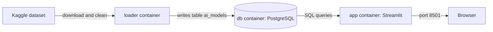

# Computing-Infrastracture
# AI model prices and abilities, 2023 to 2026
## 1. Question and dataset
How have AI model prices and abilities changed? Data: weekly snapshots of 4,297
model listings from 43 developers, 167,787 rows, from Kaggle
(author, link and licence: see the Kaggle page).
## 2. Architecture

db: PostgreSQL 16. loader: downloads, cleans and loads the data, then exits.
app: Streamlit dashboard that runs the SQL queries.
## 3. How to run
1. Install Docker Desktop.
2. `git clone <repo url>` and open the folder.
3. Copy `.env.example` to `.env`.
4. `docker compose up --build`
5. Open http://localhost:8501